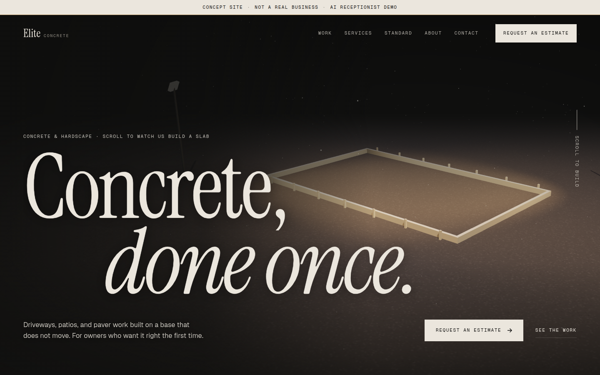

# Elite Concrete Solutions

A concept website for a concrete and hardscape contractor. It is a sales sample, not a real company: one long page a contractor could publish, with a scroll-driven 3D pour and a chat widget standing in for an AI receptionist.



The phone number, email, hours, reviews, and photos are placeholders. The estimate form does the math and then stops. It does not send a lead. Search engines are asked not to index the page.

## What you can do on the page

- **Watch a slab get built.** Scroll, and a Three.js scene grades, reinforces, pours, finishes, and cures a slab behind the copy.
- **Size a job.** Length, width, and thickness become area, cubic yards (plus 10% for waste), and truck loads.
- **Look through the work.** Six services sit in a sideways collection on a wide screen. Five projects open in a lightbox.
- **Read the hours.** On a phone, the call bar marks the sample schedule open or closed: Monday to Friday, 8am to 6pm Central.
- **Talk to the demo receptionist.** A LeadConnector chat widget loads at the bottom of the page.

## Run it locally

From this folder:

```bash
python3 -m http.server 8080
```

Then open [http://localhost:8080/](http://localhost:8080/).

Use a local server rather than opening `index.html` as a file. The 3D scene, fonts, and chat widget load from the network, so the browser needs an internet connection.

## Deploy on GitHub Pages

The site is static. [`.github/workflows/pages.yml`](.github/workflows/pages.yml) publishes it.

1. On GitHub, open **Settings → Pages**.
2. Under **Build and deployment**, set **Source** to **GitHub Actions**.
3. Merge the site to `main`. The workflow checks the HTML and the links, then publishes the page.
4. When the run finishes, the site URL is on the job summary and on the Pages settings screen.

For this repository that address is [https://ladariusjackson1.github.io/elite-concrete/](https://ladariusjackson1.github.io/elite-concrete/).

The published site is `index.html`, `css/`, `js/`, and `images/`. The README and the screenshot stay in the repository.

To publish again without a new commit, open the **Actions** tab, choose **Deploy to GitHub Pages**, and run the workflow by hand.

## Checks

[`.github/workflows/ci.yml`](.github/workflows/ci.yml) runs on every pull request. It does two things:

- Checks `index.html` with the Nu Html Checker.
- Checks the links in the page and in this README, including pictures, styles, scripts, and in-page anchors.

A push to `main` runs that same check, and the site is published only if the check passes.

## Files

- `index.html` is the page.
- `css/styles.css` is the layout and type.
- `js/main.js` is the scroll scene, gallery, menu, and estimator.
- `images/` holds the project photos.
